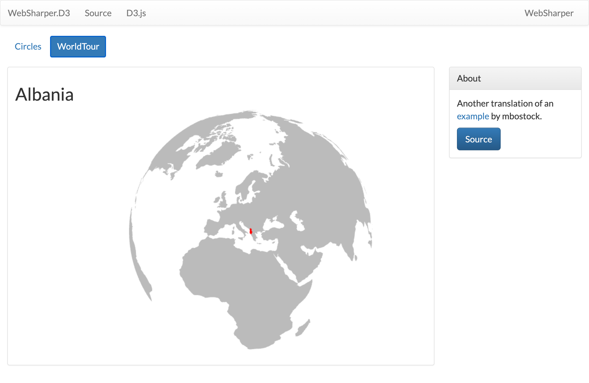

# WebSharper.D3

[](https://www.nuget.org/packages/WebSharper.D3)

[WebSharper][ws] bindings for [D3.js][d3] — strongly typed access to D3's
data-driven DOM API from F# and C#: selections, data joins, transitions,
scales, shapes, geo projections and the Promise-based fetch helpers. The
binding tracks **D3 v7.9** and consumes it from the `d3` npm package.

D3 allows you to bind arbitrary data to a Document Object Model (DOM), and then
apply data-driven transformations to the document. For example, you can use D3
to generate an HTML table from an array of numbers, or use the same data to
create an interactive SVG bar chart with smooth transitions and interaction.

D3 is not a monolithic framework that seeks to provide every conceivable
feature. Instead, D3 solves the crux of the problem: efficient manipulation of
documents based on data. This avoids proprietary representation and affords
extraordinary flexibility, exposing the full capabilities of web standards such
as CSS3, HTML5 and SVG. With minimal overhead, D3 is extremely fast, supporting
large datasets and dynamic behaviors for interaction and animation. D3's
functional style allows code reuse through a diverse collection of components
and plugins.

This repository contains:

| Project | Purpose |
| --- | --- |
| `WebSharper.D3` | The binding: WIG definitions for the D3 v7 API. |
| `Site` | The sample: a Circles demo (selections, data joins, transitions) and mbostock's World Tour (geo projections and animated transitions). |

## Live demos

**Try it live:** [Open the sample in your browser](https://dotnet-websharper.github.io/d3/)



The sample doubles as the binding's test case: **Circles** joins an array of
numbers to SVG circles, and **World Tour** renders a rotating orthographic globe
using the v7 geo path, centroid and transition APIs while loading TopoJSON and
TSV data through the Promise-based fetch helpers.

- **Sample (this repository):** <https://dotnet-websharper.github.io/d3/>
- **Sample in the WebSharper samples gallery:** <https://websharper-samples.github.io/D3/>
- **Sample source in the gallery:** <https://github.com/websharper-samples/D3>
- **WebSharper:** <https://websharper.com>
- **Binding source:** <https://github.com/dotnet-websharper/d3>

## Install

```bash
dotnet add package WebSharper.D3
```

Or with Paket:

```fsharp
nuget WebSharper.D3
```

The binding targets `netstandard2.0` and works with WebSharper 10 and later.

Because D3 is consumed from npm rather than a CDN script, the package declares a
`d3` entry in `NpmDependencies`. Restore it into your web project with
[`femto`][femto]:

```bash
dotnet tool install femto --global
femto            # add d3 to package.json and install it
```

Then bundle your web project as usual (for example with
[esbuild][esbuild]). The binding compiles to `import * as d3 from "d3"`, so a
bundler resolves the module — no global `d3` script tag is needed.

## Usage

Open the binding namespace and call the fluent D3 API from a `[<JavaScript>]`
module:

```fsharp
open WebSharper
open WebSharper.JavaScript
open WebSharper.D3

[<JavaScript>]
let Draw (host: Dom.Element) =
    D3.Select(host)
        .Append("svg")
        .Attr("width", 640)
        .Attr("height", 320) |> ignore
```

### Selections

For modifying DOM elements, D3 employs a declarative approach, operating on
arbitrary sets of nodes called selections. For example, you can change the text
color of paragraph elements:

```fsharp
D3.SelectAll("p").Style("color", "white") |> ignore
```

Yet you can still manipulate individual nodes as needed:

```fsharp
D3.Select("body").Style("background-color", "black") |> ignore
```

Selectors are defined by the [W3C Selectors API][w3cselectorsapi] and supported
natively by modern browsers. Backwards-compatibility for older browsers can be
provided by [Sizzle][sizzle]. The above examples select nodes by tag name (`p`
and `body`, respectively). Elements may be selected using a variety of
predicates, including containment, attribute values, class and ID.

D3 provides numerous methods for mutating nodes: setting attributes or styles;
registering event listeners; adding, removing or sorting nodes; and changing
HTML or text content. These suffice for the vast majority of needs. Direct
access to the underlying DOM is also possible, as each D3 selection is simply an
array of nodes.

### Dynamic properties

Readers familiar with other DOM frameworks such as [jQuery][jquery] or
[Prototype][prototypejs] should immediately recognize similarities with D3. Yet
styles, attributes, and other properties can be specified as functions of data
in D3, not just simple constants. Despite their apparent simplicity, these
functions can be surprisingly powerful; the `d3.geoPath` function, for example,
projects [geographic coordinates][geocoordinates] into [SVG path data][pathdata].
D3 provides many built-in reusable functions and function factories, such as
graphical primitives for area, line and pie charts.

For example, to randomly color paragraphs:

```fsharp
D3.SelectAll("p").Style("color", fun _ ->
    let r = int (System.Random().NextDouble() * 360.)
    "hsl(" + string r + ",100%,50%)"
) |> ignore
```

To alternate shades of gray for even and odd nodes:

```fsharp
D3.SelectAll("p").Style("color", fun (_, i) ->
    if i % 2 = 0 then "#eee" else "#fff"
) |> ignore
```

Computed properties often refer to bound data. Data is specified as an array of
values, and each value is passed as the first argument (`d`) to selection
functions. With the default join-by-index, the first element in the data array
is passed to the first node in the selection, the second element to the second
node, and so on. For example, if you bind an array of numbers to paragraph
elements, you can use these numbers to compute dynamic font sizes:

```fsharp
D3.SelectAll("p")
    .Data([| 4; 8; 15; 16; 23; 42 |])
    .Style("font-size", fun (d, _) -> string d + "px") |> ignore
```

Once the data has been bound to the document, you can omit the `data` operator;
D3 will retrieve the previously-bound data. This allows you to recompute
properties without rebinding.

### Enter and exit

Using D3's "enter" and "exit" selections, you can create new nodes for incoming
data and remove outgoing nodes that are no longer needed.

When data is bound to a selection, each element in the data array is paired with
the corresponding node in the selection. If there are fewer nodes than data, the
extra data elements form the enter selection, which you can instantiate by
appending to the `Enter` selection. For example:

```fsharp
D3.Select("body").SelectAll("p")
    .Data([| 4; 8; 15; 16; 23; 42 |])
    .Enter().Append("p")
    .Text(fun d -> "I'm number " + string d + "!") |> ignore
```

Updating nodes are the default selection — the result of the `Data` operator.
Thus, if you forget about the enter and exit selections, you will automatically
select only the elements for which there exists corresponding data. A common
pattern is to break the initial selection into three parts: the updating nodes
to modify, the entering nodes to add, and the exiting nodes to remove.

```fsharp
// Update...
let p =
    D3.Select("body").SelectAll("p")
        .Data([| 4; 8; 15; 16; 23; 42 |])
        .Text("updated") |> ignore

// Enter...
p.Enter().Append("p")
    .Text("new") |> ignore

// Exit...
p.Exit().Remove() |> ignore
```

By handling these three cases separately, you specify precisely which operations
run on which nodes. This improves performance and offers greater control over
transitions. For example, with a bar chart you might initialize entering bars
using the old scale, and then transition entering bars to the new scale along
with the updating and exiting bars.

D3 lets you transform documents based on data; this includes both creating and
destroying elements. D3 allows you to change an existing document in response to
user interaction, animation over time, or even asynchronous notification from a
third party. A hybrid approach is even possible, where the document is initially
rendered on the server, and updated on the client via D3.

### Transformation, not representation

D3 is not a new graphical representation. Unlike [Processing][processing],
[Raphaël][raphael], or [Protovis][protovis], the vocabulary of marks comes
directly from web standards: HTML, SVG and CSS. For example, you can create SVG
elements using D3 and style them with external stylesheets. You can use
composite filter effects, dashed strokes and clipping. If browser vendors
introduce new features tomorrow, you'll be able to use them immediately — no
toolkit update required. And, if you decide in the future to use a toolkit other
than D3, you can take your knowledge of standards with you!

Best of all, D3 is easy to debug using the browser's built-in element inspector:
the nodes that you manipulate with D3 are exactly those that the browser
understands natively.

### Transitions

D3's focus on transformation extends naturally to animated transitions.
Transitions gradually interpolate styles and attributes over time. Tweening can
be controlled via easing functions such as "elastic", "cubic-in-out" and
"linear". D3's interpolators support both primitives, such as numbers and
numbers embedded within strings (font sizes, path data, etc.), and compound
values. You can even extend D3's interpolator registry to support complex
properties and data structures.

For example, to fade the background of the page to black:

```fsharp
D3.Select("body").Transition()
    .Style("background-color", "black") |> ignore
```

Or, to resize circles in a symbol map with a staggered delay:

```fsharp
D3.SelectAll("circle").Transition()
    .Duration(750)
    .Delay(fun (_, i) -> i * 10)
    .Attr("r", fun (d, _) -> sqrt (d * scale)) |> ignore
```

By modifying only the attributes that actually change, D3 reduces overhead and
allows greater graphical complexity at high frame rates. D3 also allows
sequencing of complex transitions via events. And, you can still use CSS3
transitions; D3 does not replace the browser's toolbox, but exposes it in a way
that is easier to use.

## Notes on the API

- **D3 v7.** The binding targets D3 v7.9 and is loaded from npm. The old
  v3/v4 sub-namespaces (`d3.geo`, `d3.geom`, `d3.layout`, `d3.scale`,
  `d3.behavior`, `d3.time`, `d3.ns`, `d3.random`, `d3.timer`) are gone; their
  contents are exposed at the top level (`D3.GeoPath`, `D3.ScaleLinear`,
  `D3.Drag`, …).
- **Geo.** `D3.GeoPath()` / `D3.GeoPath().Projection(p)` return a geo path
  generator; `D3.Path()` is the plain path builder. `D3.GeoCentroid`,
  `D3.GeoArea`, `D3.GeoBounds`, `D3.GeoDistance`, `D3.GeoGraticule`, … are
  top-level functions.
- **Transitions.** Use the v7 form: `.Each(fun (d, i) -> …)` and
  `.On("end", fun _ -> …)`.
- **Fetch helpers.** `D3.Json`, `D3.Csv`, `D3.Tsv`, … take a URL and return a
  `Promise`; use `.Then(...)` (see `Site/WorldTour.fs` for an `Async` bridge).
- **Typing aids.** `AttrFn` / `AttrIx` are aliases for `Attr` with a data- or
  index-dependent value, for better completion. Use WebSharper's `As` helper
  when a function accepts several shapes; the cast is erased from the generated
  JavaScript.

## Build from source

### Prerequisites

- [.NET SDK][dotnet] 10.0 or later.
- [Node.js][node] (LTS) for the esbuild bundle step.
- [Paket][paket] as a local dotnet tool (already configured in
  `.config/dotnet-tools.json`).

### Restore and build

```bash
dotnet tool restore
dotnet build WebSharper.D3.sln -c Release
```

### Run the sample

Building `Site` in Release emits the self-contained static site in `build/html`
and runs the `esbuild` bundle step automatically (it installs the npm `d3`
dependency and produces `Content/Site.bundle.js`):

```bash
dotnet build Site/Site.fsproj -c Release
cd build/html
python3 -m http.server 8080     # or: npx serve .
```

Then open <http://localhost:8080/> and pick **Circles** or **World Tour**.

### Pack the NuGet package

After a Release build:

```bash
dotnet paket pack ./out
```

### Deployment

The sample is published to the repository's GitHub Pages site
(<https://dotnet-websharper.github.io/d3/>) from the `gh-pages` branch; the
build output to publish is `build/html`.

## Repository layout

```text
WebSharper.D3/
  Main.fs                  # WIG definition of the D3 v7 API
  WebSharper.D3.fsproj     # NpmDependencies = d3
Site/
  Circles.fs               # selections / data join / transitions sample
  WorldTour.fs             # geo path + centroid + transition sample
  Samples.fs               # tiny sample navigator
  Client.fs                # SPA entry point
  index.html               # page shell (loads Content/Site.bundle.js)
  package.json             # d3 + esbuild
  esbuild.config.mjs       # bundles Content/Site.js -> Content/Site.bundle.js
  Content/                 # generated WebSharper/esbuild output (not committed)
docs/sample.png            # screenshot used in this README
nuget/                     # Paket pack template
LICENSE.md
```

## License

The bindings are released under the Apache 2.0 license — see
[LICENSE.md][license].

[d3]: https://d3js.org
[ws]: https://websharper.com
[femto]: https://www.nuget.org/packages/femto
[esbuild]: https://esbuild.github.io/
[dotnet]: https://dotnet.microsoft.com/download
[node]: https://nodejs.org/
[paket]: https://fsprojects.github.io/Paket/
[license]: https://github.com/dotnet-websharper/d3/blob/main/LICENSE.md
[w3cselectorsapi]: https://www.w3.org/TR/selectors-api
[sizzle]: https://sizzlejs.com
[jquery]: https://jquery.com
[prototypejs]: https://www.prototypejs.org
[geocoordinates]: https://geojson.org
[pathdata]: https://www.w3.org/TR/SVG/paths.html#PathData
[processing]: https://processing.org
[raphael]: https://raphaeljs.com
[protovis]: https://en.wikipedia.org/wiki/Protovis
